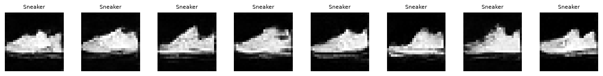
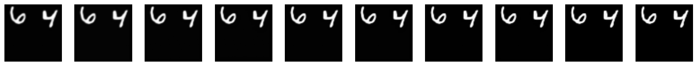
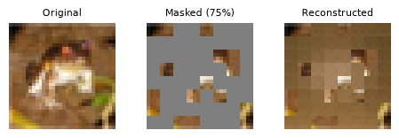
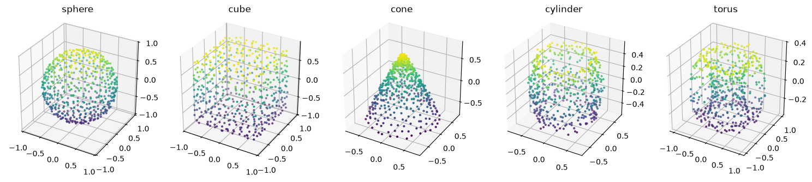

# GenAI - Multimodal Generation Lab

**Build and explore generative AI across text, images, video, vision, speech, music, and 3D with hands-on PyTorch notebooks.**



*Actual saved output from the image diffusion notebook: eight Fashion-MNIST sneaker samples generated from noise.*

This educational project walks through seven generative modeling workflows, from preparing data and implementing an architecture to training, sampling, and inspecting results. It includes a combined master notebook, individual notebooks for focused study, and optional pretrained inference examples. The master notebook also exposes a small `MultiModalHub` dispatcher for calling the trained generators through one interface.

The emphasis is understanding how models learn. These are compact teaching implementations with limited datasets and training budgets. The seven workflows cover different modalities; the project does not train a single jointly aligned multimodal foundation model.

## Notebook guide

| Modality | Notebook | Architecture and objective | Data and output |
|---|---|---|---|
| Text | [01_Text_GPT.ipynb](01_Text_GPT.ipynb) | Character-level GPT with causal self-attention and next-token cross-entropy | Tiny Shakespeare → sampled text continuations |
| Image | [02_Image_Diffusion.ipynb](02_Image_Diffusion.ipynb) | Class-conditional UNet DDPM, noise-prediction MSE, classifier-free guidance | Fashion-MNIST → 28 × 28 grayscale garment images |
| Video | [03_Video_FramePrediction.ipynb](03_Video_FramePrediction.ipynb) | ConvLSTM sequence prediction with pixel MSE and teacher forcing | Moving sequences constructed from MNIST → future frames |
| Vision | [04_Vision_MaskedImageModeling.ipynb](04_Vision_MaskedImageModeling.ipynb) | Masked autoencoder with reconstruction loss on hidden patches | CIFAR-10 → reconstructed missing image regions |
| Speech | [05_Speech_TextToSpeech.ipynb](05_Speech_TextToSpeech.ipynb) | Tacotron-style text-to-mel network with location-sensitive attention, mel and stop-token losses | Small CMU ARCTIC speaker subset → speech with Griffin–Lim waveform reconstruction |
| Music | [06_Music_SymbolicGeneration.ipynb](06_Music_SymbolicGeneration.ipynb) | GPT over note/rest/duration events with next-event prediction | Bach chorales from music21 → monophonic melodies, piano rolls, and synthesized audio |
| 3D | [07_3D_PointCloudGeneration.ipynb](07_3D_PointCloudGeneration.ipynb) | Class-conditional PointNet-style VAE with Chamfer distance and KL regularization | Procedural sphere, cube, cone, cylinder, and torus → 512-point shapes |

**Start with the complete walkthrough:** [Multi-Modal_Generative_AI_Master_Notebook.ipynb](Multi-Modal_Generative_AI_Master_Notebook.ipynb).

## What you will learn

- Prepare text vocabularies, image transforms, video sequences, mel spectrograms, music events, and unordered point sets.
- Implement attention, autoregressive decoding, diffusion denoising, recurrent visual prediction, masked reconstruction, and variational sampling.
- Match each modality to a suitable loss and training strategy.
- Use checkpoints, loss plots, sample visualizations, and notebook audio playback to inspect behavior.
- Explore temperature/top-k sampling, diffusion guidance, image masking ratios, and conditional 3D generation.
- Compare a small model trained from scratch with optional pretrained inference paths.

## Setup and first run

Use an isolated Python environment supported by the PyTorch packages you install. A CUDA-capable NVIDIA GPU is recommended for training. CPU execution is supported by the notebook device-selection logic but can take substantially longer.

```bash
git clone https://github.com/vams2krish/GenAI-Multimodal-Generation-Lab.git
cd GenAI-Multimodal-Generation-Lab
python -m venv .venv
```

Activate the environment:

```powershell
# Windows PowerShell
.\.venv\Scripts\Activate.ps1
```

```bash
# macOS / Linux
source .venv/bin/activate
```

Install a compatible `torch`, `torchvision`, and `torchaudio` set using the [official PyTorch installation selector](https://pytorch.org/get-started/locally/), choosing the build appropriate to your platform and GPU. Then install the remaining notebook dependencies:

```bash
python -m pip install -r requirements.txt
python -m jupyter lab
```

1. Open the master notebook for the full sequence, or select an individual modality notebook.
2. Select the kernel for your environment and run the global setup cells first.
3. Run the remaining cells in order. In the master notebook, later sections reuse earlier definitions, including GPT for symbolic music.
4. Allow dataset downloads on the first run. Keep the working directory at the repository root so relative paths resolve consistently.
5. Train the model before running its generation/demo cells. Adjust the step/epoch settings to your compute budget.

The setup cells also install `music21`, `soundfile`, and `imageio`. Optional pretrained paths may install additional packages and download model weights. Dependencies in `requirements.txt` are unpinned starting requirements, not a tested environment lockfile.

## Unified inference hub

After running the relevant training and definition cells in the master notebook, Section 8 constructs `hub` with seven modality routes:

```python
hub.generate("text", "ROMEO:", max_new_tokens=200)
hub.generate("image", "Sneaker", n_samples=4)
hub.generate("speech", "Hello from the multimodal notebook.")
hub.generate("3d", "sphere", n_samples=1)
```

The remaining routes are `video`, `vision`, and `music`; their inputs are context-frame tensors, image tensors, and music seed events respectively. Output types follow each notebook's generator. The hub is an in-memory dispatcher over initialized models, rather than an independently packaged service. The final section includes an illustrative Gradio UI example for text and image generation; a deployed application is not included.

## Project results gallery

The images below are extracted from existing notebook outputs. They illustrate a saved run and are not newly measured benchmarks.

### Video continuation



ConvLSTM predictions illustrate how a recurrent visual model continues simple moving-digit sequences.

### Masked image reconstruction



The vision notebook compares an input image, its masked version, and the reconstructed image.

### Conditional 3D shapes



The 3D notebook samples class-conditioned point clouds from the VAE latent space.

## Optional pretrained paths

The notebooks include optional examples for GPT-2, Stable Diffusion, pretrained video diffusion, ViT-MAE, SpeechT5 with HiFi-GAN, MusicGen, and Shap-E. These paths are controlled by notebook flags and are off by default. Inspect each example before enabling it: model downloads, hardware requirements, dependencies, access conditions, and model licenses differ.

## Data, generated files, and repository layout

```text
.
├── README.md
├── requirements.txt
├── assets/                       # Result images used in this README
├── 01_Text_GPT.ipynb
├── 02_Image_Diffusion.ipynb
├── 03_Video_FramePrediction.ipynb
├── 04_Vision_MaskedImageModeling.ipynb
├── 05_Speech_TextToSpeech.ipynb
├── 06_Music_SymbolicGeneration.ipynb
├── 07_3D_PointCloudGeneration.ipynb
└── Multi-Modal_Generative_AI_Master_Notebook.ipynb
```

Datasets are downloaded or constructed by notebook cells. Runtime directories such as `data/`, `checkpoints/`, and `outputs/` are excluded from this public source snapshot. Existing inline notebook plots and audio are retained. Downloaded datasets and pretrained weights remain subject to their respective providers' terms.

## Compute, limitations, and reproducibility

The notebook narrative reports short training runs calibrated on an RTX 2060 with 6 GB VRAM. Treat those timings as author-reported examples, not guarantees: hardware, package versions, download time, and runtime configuration affect results. The publication work did not rerun training or independently verify those timings.

Expect limited long-range coherence in tiny text models, low-resolution diffusion samples, blur in video predictions, approximate masked-image reconstruction, and low-fidelity speech from short training and Griffin–Lim inversion. Music is monophonic with simple synthesized timbre. The 3D output is a point cloud with a fixed point count, not a textured mesh.

For repeatable experiments, record your package versions, random seed, device, dataset subset, training settings, and checkpoint. The notebooks provide seed and checkpoint helpers, but exact numerical agreement across devices is not guaranteed.

## Troubleshooting

- **GPU is not detected:** check `torch.cuda.is_available()` and install the appropriate PyTorch build for your platform and driver.
- **Missing variables or models:** restart the kernel and execute the notebook from its setup cells in order.
- **Out of GPU memory:** reduce batch size or model size and leave unused pretrained paths disabled.
- **Dataset download fails:** verify connectivity and write access to `data/`, then rerun the preparation cell.
- **Speech package/backend errors:** keep PyTorch-family versions compatible; the notebook uses `soundfile` for waveform reading to avoid relying on an optional torchaudio decoding backend.

## Extending the project

Possible next steps include larger datasets, longer training, polyphonic music encoding, neural speech vocoders, improved video generation objectives, point-cloud diffusion, and cross-modal conditioning. The master notebook discusses LoRA, quantization, and UI integration as extension ideas; these are not complete production features in this repository.

## Author and reuse

Maintained by [Vamshi Krishna Adam](https://github.com/vams2krish). Questions and reproducible bug reports can be shared through this repository's Issues tab. Include the notebook name, runtime versions, device, and relevant error message.

No project license has been selected in this publication. Public visibility alone does not grant an open-source license. Dataset, model, and dependency licenses apply separately.
